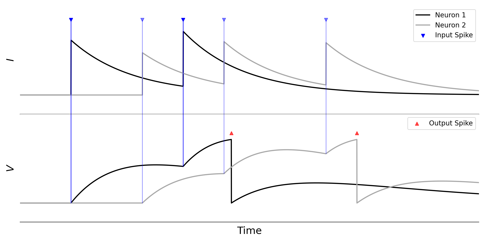
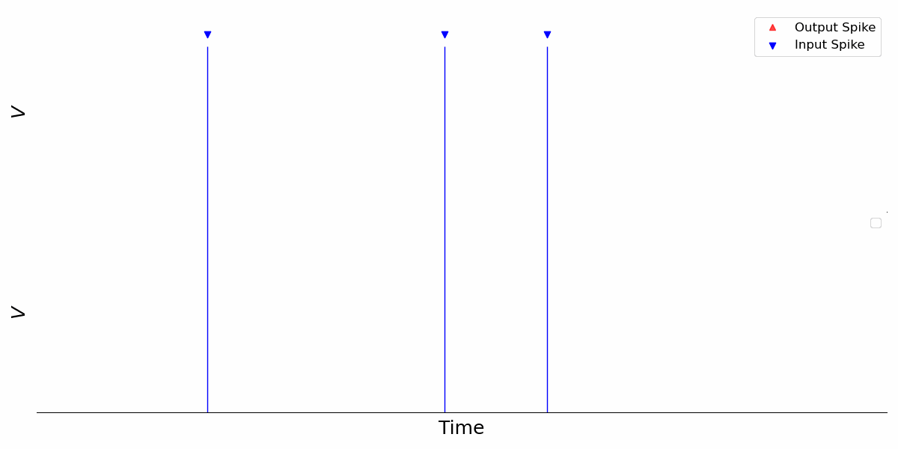
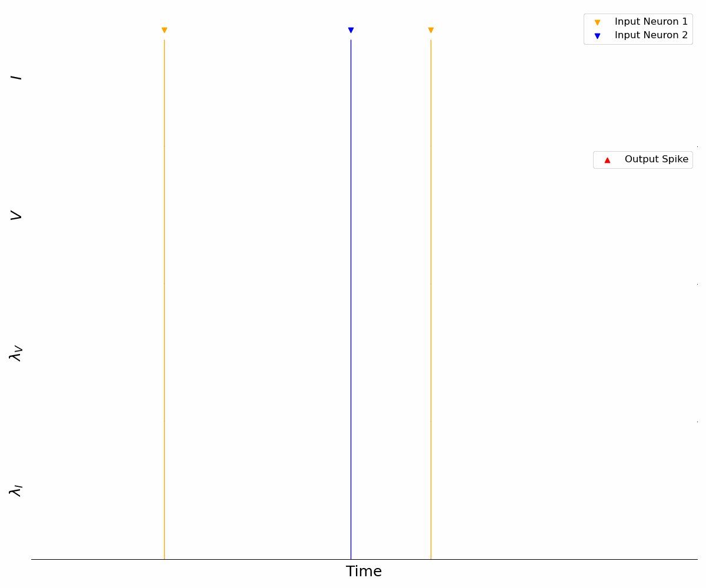
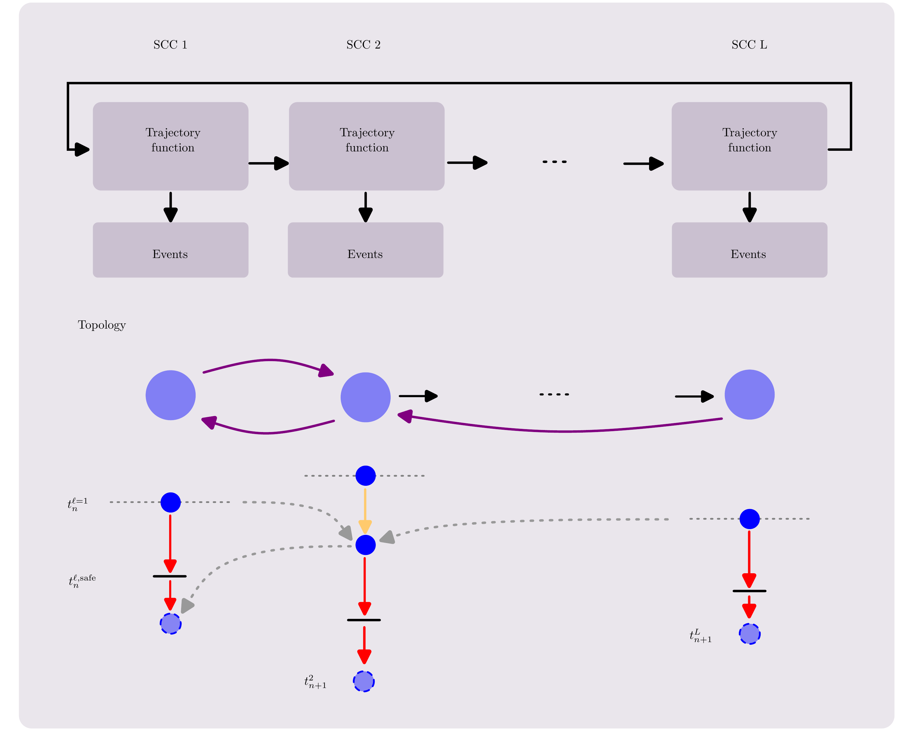
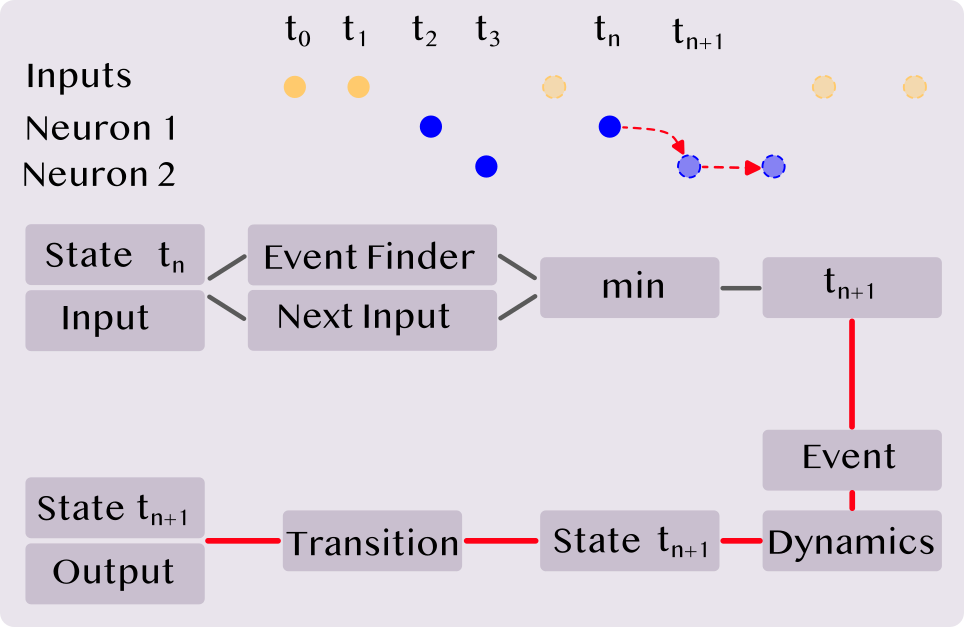

Training an SNN on BrainScaleS-2 with `jaxsnn` and EventProp
============================================================

In this tutorial we create and train a spiking neural network (SNN) on the neuromorphic hardware system BrainScaleS-2 (BSS-2) [1].
Particularly, we use the event-based `jaxsnn` [3] software framework to solve the Yin-Yang dataset [2].
For training we rely on the EventProp [5] algorithm.
`jaxsnn` is a JAX-based [4] library to simulate SNNs and optimize them in an event-driven manner, also on neuromorphic hardware.
This tutorial will outline and showcase the basic principles of `jaxsnn` and how to use it to train an SNN on BSS-2.

Spiking Neural Networks
-----------------------

SNNs are composed of neurons that communicate through discrete spike events in continuous time.
Unlike traditional artificial neural networks, SNNs incorporate temporal dynamics, where each neuron’s internal state—such as membrane potential :math:`V` and synaptic current :math:`I`—evolves over time according to biophysically-inspired equations.
Information is transmitted via spikes: when a neuron’s membrane potential reaches a threshold, it emits a spike, which is then received by post-synaptic neurons, triggering state changes in the neuron itself and its partners, thereby enabling complex temporal information processing.

One commonly used neuron model is the leaky integrate-and-fire (LIF) neuron model described by the equations:

.. math::
    \begin{align*}
        & \text{Free dynamics}                  && \quad \text{Transition condition}              && \quad \text{Jumps at transition}   \\
        &\tau_{\mathrm{m}} \dot{V} = - V + I    && \quad (V)_{n} - V_{\mathrm{th}} = 0 \text{, }(\dot{V})_{n} > 0    && \quad (V^{+})_{n} = V_{\mathrm{reset}}              \\
        &\tau_{\mathrm{s}} \dot{I} = - I        && \quad \text{for any } n                        && \quad I^{+} = I^{-} + W e_{n}
    \end{align*}

The free dynamics describe how the neuron state (:math:`I`, :math:`V`) evolves continuously over time.
When certain transition conditions are met—such as a neuron’s membrane potential crossing its threshold :math:`V_{\mathrm{th}}` or the arrival of a synaptic event—the neuron state undergoes discrete jumps.
Here, :math:`V_{\mathrm{reset}}` is the reset potential and :math:`\tau_{\mathrm{m}}` and :math:`\tau_{\mathrm{s}}` denote the membrane and synaptic time constants, respectively.
:math:`n` indexes the neuron.

The figure below illustrates how the states of two neurons evolve over time as they receive events through different synapses:

A key concept in SNNs is that both input and output, as well as internal communication between neurons, occur via spike events.
Each spike event can be represented as a tuple :math:`(t_\mathrm{spike}, n)`, indicating the time and the neuron index.
Thus, the output of an SNN is typically a sequence (e.g. a list) of such events.

This event-based processing paradigm is why SNNs are described as performing event-driven information processing: they operate directly on streams of discrete events rather than continuous signals.

Optimizing SNNs
---------------

There are several approaches to optimizing spiking neural networks (SNNs) for a given task.
In many machine learning applications, the neural dynamics of SNNs are discretized in time and integrated numerically.
In such modeling schemes, network spikes are represented as binary tensors of shape `(time_steps, neuron_index)`, where a value of `1` indicates a spike event at a particular time step, and `0` otherwise.
This discretization enables the use of established machine learning techniques, as SNNs can then be treated as recurrent neural networks (RNNs) and trained using backpropagation through time (BPTT).

However, simulating SNNs on a discrete time grid introduces some limitations.
The temporal resolution of spike times—and thus the information processing in the network—is constrained by the time step size.
Achieving high temporal precision requires a fine time grid, which can significantly increase computational complexity, especially when spiking activity is sparse and much computation is spent simulating periods without events.

To address these challenges, event-driven (or event-stepped) simulation offers a more efficient alternative. Instead of evolving the network state at every fixed time step, the simulation advances from one spike event to the next.
This approach enables the use of real-valued spike times and aligns naturally with event-driven neuromorphic hardware, which processes and generates spikes with high temporal precision.
Instead of dense binary tensors, spike data is represented more efficiently as sequences of discrete spike events. SNNs can be optimized in an event-driven manner using the EventProp [5] algorithm.

In the plot below the difference between event-stepped and time-gridded is visualized:

For event-stepped simulation and optimization of SNNs, we have developed the `jaxsnn` [3] library, which is the focus of this tutorial.

EventProp for Event-stepped Optimization
~~~~~~~~~~~~~~~~~~~~~~~~~~~~~~~~~~~~~~~~

In EventProp [5] we consider loss functions, which are to be minimized to solve a given task, of the form

.. math::
    L = l_{\mathrm{p}} (t^{\mathrm{post}}) + \int_{0}^{T} l_{V} (V, t) \mathrm{d}t,

where :math:`l_{\mathrm{p}}(t^{\mathrm{post}})` and :math:`l_{V} (V, t)` are smooth loss functions depending on the membrane potentials :math:`V`, time :math:`t` and set of post-synaptic spike times :math:`t^\mathrm{post}`.

The system’s forward dynamics, defined in the table above, can be introduced as constraints via Lagrange multipliers :math:`\lambda_{V}` and :math:`\lambda_{I}`, referring to the equation of the respective state variable.
From this, an adjoint system of differential equations for the Lagrange multipliers can be found and solved in reverse time.
They also undergo jumps at the spike times of neurons found by solving (or in our case emulating) the forward dynamics.
Using the notation :math:`’ = -\frac{\mathrm{d}}{\mathrm{d} t}`, the adjoint equations are

.. math::
    \begin{align*}
        & \text{Free dynamics} && \quad \text{Transition condition} && \quad \text{Jumps at transition} \\
        & \tau_{\mathrm{m}} \lambda^{\prime}_{V} = - \lambda_{V} + \frac{\partial l_{V}}{\partial V}
        && \quad t - t^{\mathrm{post}}_{k} = 0
        && \quad \left(\lambda_{V}^{-} \right)_{n(k)} = \left(\lambda_{V}^{+} \right)_{n(k)} + \frac{1}{\tau_{\mathrm{m}} (\dot{V}^{-})_{n(k)} } \bigg[ \vartheta \left(\lambda_{V}^{+} \right)_{n(k)} \\
        & \tau_{\mathrm{s}} \lambda^{\prime}_{I} = - \lambda_{I} + \lambda_{V}
        && \quad \text{for any } k
        && \quad\quad + \left( W^{\top} \left( \lambda_{V}^{+} - \lambda_{I} \right) \right) + \frac{\partial l_{\mathrm{post}}}{\partial t^{\mathrm{post}}_{k}} + l_{V}^{-} - l_{V}^{+} \bigg]
    \end{align*}

The gradient with respect to the synaptic weight :math:`w_{ji}`, connecting pre-synaptic neuron :math:`i` to post-synaptic neuron :math:`j`, then only depends on the synaptic time constant :math:`\tau_\mathrm{s}` and the adjoint variable :math:`\lambda_{I}` at spike times:

.. math::
    \frac{\mathrm{d} L}{\mathrm{d}w_{ji}} = - \tau_{\mathrm{s}}
    \sum_{\text{spikes from } i} (\lambda_{I})_{j}

The ``jaxsnn`` Library for Event-driven Learning
------------------------------------------------

The `jaxsnn` library provides a powerful and flexible framework for event-driven learning with spiking neural networks (SNNs), supporting both simulation and deployment on neuromorphic hardware.
Built on top of JAX, it leverages the strengths of NumPy while offering advanced features such as vectorization, automatic differentiation, and just-in-time (JIT) compilation for efficient computation.
If you are new to JAX, you can find an introductory tutorial [here](https://docs.jax.dev/en/latest/tutorials.html).

In `jaxsnn`, we follow the init-apply function approach.
A network is described by a `Topology` to which modules, i.e. populations such as `Source` and `LIF` and projections such as `Linear`, are added and connected.
From this, an init function initializing the network's parameters and an apply function which defines the forward and backward pass of the network are created.
For example we can create a network with a `LIF` layer receiving spikes from a `Source` like this:

.. code:: ipython3

    import jax
    from jaxsnn.event.modules import Source, Linear, LIF, LIFParameters
    from jaxsnn.event.topology import Topology

    # We use v_reset=-1000.0 to ensure the neuron only spikes once
    # For analytical event-based gradients in the LIF implementation tau_mem = 2*tau_syn or tau_syn = tau_mem must hold
    lif_params = LIFParameters(
        v_reset=-1000.0,
        v_th=1.0,
        tau_syn=6e-3,
        tau_mem=12e-3,
    )

    builder = Topology(t_max=0.4)
    builder.add({
        "inp": Source(size=2),
        "syn": Linear(mean=2.8, std=0.02),
        "lif": LIF(size=1, n_steps=4, params=lif_params)
    })
    builder.connect(
        [("inp", "syn"),
         ("syn", "lif")]
    )
    init_fn, apply_fn = builder.done()

    print("Init function:", init_fn)
    print("Apply function:", apply_fn)

Types
-----

In `jaxsnn`, the `apply_fn` takes the batched input spikes of each source and the parameters of the network as input, and returns the events of each module.

.. code:: ipython3

    from jaxsnn.event.types import Spike
    import jax.numpy as jnp

    # Some input spikes
    input_spikes = {
        "inp": Spike(
            time=jnp.array([[0.01, 0.022]]),
            idx=jnp.array([[0, 1]]),
            current=jnp.array([[0., 0.]]),
            layer_idx=jnp.array([[0, 0]]),
            internal=jnp.array([[True, True]])
        )
    }
    print("Input spikes:", input_spikes)

    # Initialize the parameters
    rng = jax.random.PRNGKey(42)
    weights = init_fn(rng)
    print("Weights:", weights)
    print("Weights shape:", weights["syn"].shape)

.. code:: ipython3

    # Forward
    events = apply_fn(input_spikes, weights)
    output = events["lif"]
    # The events of a layer include its input events, its own spikes are marked as internal
    print("Output spike:", output[output.internal])

Composing Topologies
--------------------

Multiple layers can be composed by adding them to a `Topology` and connecting them, enabling the construction of complex SNN architectures.
Besides feed-forward architectures, arbitrary topologies including recurrence and delays are supported [6].

.. code:: ipython3

    builder = Topology(t_max=0.3)
    builder.add({
        "inp": Source(size=2),
        "syn1": Linear(mean=0.3, std=0.3),
        "lif1": LIF(size=500, n_steps=100, params=lif_params),
        "syn2": Linear(mean=0.5, std=0.8),
        "lif2": LIF(size=42, n_steps=50, params=lif_params)
    })
    builder.connect([
        ("inp", "syn1"),
        ("syn1", "lif1"),
        ("lif1", "syn2"),
        ("syn2", "lif2")
    ])
    init_fn, apply_fn = builder.done()

`jaxsnn` supports JAX's function transformations
------------------------------------------------

The important thing to notice here is that those functions are pure Python functions working on JAX-compatible data types which can be transformed by ``JAX``\ ´s function transformations.
Hence, ``vmap``\ ping for adding a batch dimension (note, that the `apply_fn` is already batched), computing gradients via ``JAX``\ ’s auto-diff engine and JIT-compilation is fully supported.

.. code:: ipython3

    # JITing the apply function
    apply_fn_jit = jax.jit(apply_fn)
    print("JITted apply function:", apply_fn_jit)

    # Adding a batch dimension to the apply function (note that apply_fn is already batched)
    apply_fn_batched = jax.vmap(apply_fn, in_axes=(0, None))
    print("Batched apply function:", apply_fn_batched)

    # Computing the gradient of the apply function
    apply_fn_grad = jax.grad(apply_fn, argnums=1)
    print("Gradient of apply function:", apply_fn_grad)

Events from a Neuromorphic Backend
-----------------------------------
The following draft shows how the forward dynamics of a model can be dispatched to a neuromorphic backend and the gradients can be computed based on return values from the hardware.

.. code:: python

    import jax
    from mymodel import loss_fn, run_on_hw, calc_grads

    @jax.custom_vjp
    def apply_fn(in_spikes, params):
        # dispatch experiment to neuromorphic hardware
        return jax.pure_callback(run_on_hw, out_type, params, in_spikes)

    def apply_forward(in_spikes, params):
        # dispatch experiment to neuromorphic hardware
        hw_obsv = jax.pure_callback(run_on_hw, out_type, params, in_spikes)
        # keep what the gradient computation needs, incl. the recordings
        # possibly also model vjp for gradient computation in backward
        return hw_obsv, (params, in_spikes, hw_obsv)

    def apply_backward(res, g):
        # params, in_spikes, hw_obsv = res
        grad_in_spikes, grad_params = calc_grads(res, g)
        return (grad_in_spikes, grad_params)

    apply_fn.defvjp(apply_forward, apply_backward)
    # in_spikes and params defined
    grads = jax.grad(partial(loss_fn, apply_fn))(in_spikes, params)

Event-stepping
--------------

The topology's `apply_fn` splits the network graph into its independent strongly connected components (SCCs) and executes each SCC in topological order.
Each SCC’s `apply_fn` function defines the SCC's forward dynamics, which may be computed using either event-based or time-gridded approaches.

In our framework, event-based `apply_fn` functions follow a specific structure, illustrated in the figure below. For each `apply_fn` function, we specify the number of events (`n_steps`) to process, which includes both input events and internal events (such as output spikes from LIF neurons).
At each event step, we determine whether and when the next output event will occur, based on the current neuron states of the layer at time :math:`t_n`.

This is accomplished by the “Event Finder,” a component that computes the next spike time given the current state.
The Event Finder can for instance use analytical formulas or numerical root-finding algorithms to detect threshold crossings.
If the computed output event occurs before the next input spike, we emit an output event with the spike time and neuron index.
Otherwise, if the next input spike occurs earlier, we return the input event.

After identifying the next event, we evolve all neuron states in the network to the corresponding time :math:`t_{n+1}`, using the neuron model’s temporal dynamics.
We then apply the appropriate state transitions for the event: for input events, this might involve increasing the input current of receiving neurons and for output events, the membrane potential may be reset.
The specifics of event finding, state transitions, and dynamics are determined by the neuron model.

Crucially, if all these operations are differentiable—such as when using analytical solutions for the forward dynamics (see TTFS [7])—then `jax.grad` can automatically compute gradients in an event-stepped manner.
Alternatively, custom event-stepped gradients can be implemented, for example like the EventProp algorithm, which supports more general neuron dynamics.

Learning a Spike Time
---------------------

To help you get started with ``jaxsnn``, we will begin with a simple experiment: training a single leaky integrate-and-fire (LIF) neuron to emit a spike at a desired target time :math:`t_\mathrm{target}`.

.. code:: ipython3

    target_time = 0.015

    builder = Topology(t_max=0.4)
    builder.add({
        "inp": Source(size=2),
        "syn": Linear(mean=2.8, std=0.02),
        "lif": LIF(size=1, n_steps=4, params=lif_params)
    })
    builder.connect([
        ("inp", "syn"),
        ("syn", "lif"),
    ])
    init_fn, apply_fn = builder.done()

    input_spikes = {
        "inp": Spike(
            time=jnp.array([[0.01, 0.022]]),
            idx=jnp.array([[0, 1]]),
            current=jnp.array([[0., 0.]]),
            layer_idx=jnp.array([[0, 0]]),
            internal=jnp.array([[True, True]])
        )
    }

    # Initialize the parameters
    rng = jax.random.PRNGKey(42)
    weights = init_fn(rng)

    # We now define a loss function that computes the squared error between the output spike time and a target time
    def loss_fn(weights, input_spikes, target_time):
        output_spikes = apply_fn(input_spikes, weights)["lif"]
        spike_time = output_spikes.time[0][jnp.argmax(output_spikes.internal[0])]
        return jnp.mean((spike_time - target_time) ** 2), spike_time

.. code:: ipython3

    rng = jax.random.PRNGKey(42)

    # We can use JAX's grad function to compute the gradient of the loss with respect to the weights
    backward_fn = jax.value_and_grad(loss_fn, has_aux=True)

    weights = init_fn(rng)

    for epoch in range(5):
        (value, time), grad = backward_fn(weights, input_spikes, target_time)
        weights = jax.tree_util.tree_map(lambda w, g: w - 1000. * g, weights, grad)
        print("Epoch {}: Loss: {:.7f}, Spike time: {:.7f}".format(epoch, value, time))

.. code:: ipython3

    from _static.tutorial.jaxsnn_plots import plot_training_progress
    import numpy as np

    # Define a function to compute one epoch of training
    def epoch_fn(state, i):
        weights, input_spikes = state
        (value, time), grad = jax.value_and_grad(loss_fn, has_aux=True)(weights, input_spikes, 0.015)
        weights = jax.tree_util.tree_map(lambda w, g: w - 500. * g, weights, grad)
        return (weights, input_spikes), (value, time, weights)

    # Initialize
    weights = init_fn(rng)

    # We can use JAX's lax.scan to unroll the training loop
    # This implicitly jit compiles the loop, which leads to better performance
    _, (loss, times, weights) = jax.lax.scan(epoch_fn, (weights, input_spikes), jnp.arange(600))

    # Plot
    weights_arr = np.array([w.squeeze() for w in weights["syn"]])
    plot_training_progress(loss, times, weights_arr)

Training an SNN on BSS-2 to solve the Yin-Yang Dataset
------------------------------------------------------

In this example, we train a simple LIF network with one hidden layer to solve the Yin-Yang task on the BrainScaleS-2 neuromorphic hardware.

.. code:: ipython3

    from functools import partial
    from jaxsnn.base.dataset import yinyang_dataset

    rng = jax.random.PRNGKey(42)
    param_rng, train_rng, test_rng = jax.random.split(rng, 3)

    batch_size = 64
    n_train_batches = 78
    n_test_batches = 46
    train_samples = batch_size * n_train_batches
    test_samples = batch_size * n_test_batches

    xy_trainset = yinyang_dataset(
        train_rng,
        train_samples,
        mirror=True,
        bias_spike=0.0,
    )
    xy_testset = yinyang_dataset(
        test_rng,
        test_samples,
        mirror=True,
        bias_spike=0.0,
    )
    print(f"Trainset: {xy_trainset}")

The Yin-Yang dataset
--------------------

.. code:: ipython3

    from _static.tutorial.jaxsnn_plots import plot_trainset_samples
    import numpy as np

    # Extract data and targets from trainset
    data, targets, _ = xy_trainset

    # Select one random sample
    random_index = np.random.randint(0, len(data))
    random_sample = (data[random_index], targets[random_index])

    # Call the function
    plot_trainset_samples(data[:500], targets[:500], random_sample)

    # Keep the random sample as a variable
    random_sample

Input encoding
~~~~~~~~~~~~~~

If we want to use an SNN to classify a sample :math:`i` in the Yin-Yang dataset, we have to translate the point :math:`(x_i, y_i)` to spikes.
For this, we translate the value in each dimension, as well as their inverse :math:`(1-x_i, 1-y_i)`, to a spike time :math:`t_n^i` of an input neuron :math:`n` into a range :math:`[t_\text{early}, t_\text{late}]` [2]:

.. math::

   \begin{bmatrix}
       x_{i} \\
       y_{i} \\
       1 - x_{i} \\
       1 - y_{i} \\
   \end{bmatrix}
   \longrightarrow
   \begin{bmatrix}
       t^i_0 \\
       t^i_1 \\
       t^i_2 \\
       t^i_3
   \end{bmatrix}
   = t_\text{early} +
   \begin{bmatrix}
       x_{i} \\
       y_{i} \\
       1 - x_{i} \\
       1 - y_{i}
   \end{bmatrix}
   \left( t_\text{late} - t_\text{early} \right)

.

To increase activity in the network we add an additional input neuron that has a constant firing time :math:`t^\text{bias}`, such that sample :math:`i` is represented by the spike events :math:`(t^i_0, t^i_1, t^i_2, t^i_3, t^\text{bias}_4)^\top`.

The dataset ``yinyang_dataset`` returns each data point in the form :math:`(x_i, y_i, 1-x_i, 1-y_i)`.
To translate them into spike times we use the encoding function ``spatio_temporal_encode``.
Additionally, we also encode the target class into spike times.
Our SNN has three output neurons, one for each class, and we want the correct neuron to spike earlier than the incorrect neurons.
For this, the ``target_temporal_encode`` function translates the target class into a target spike time `correct_target_time` for the correct class and a target spike time `wrong_target_time` for the incorrect classes.

.. code:: ipython3

    from jaxsnn.event.encode import spatio_temporal_encode, target_temporal_encode, encode

    t_late = 2.0 * 6e-6
    t_max = 4.0 * 6e-6

    # Encoding
    input_encoder_batched = jax.jit(jax.vmap(partial(
        spatio_temporal_encode,
        t_late=t_late,
        duplication=5,
        duplicate_neurons=True,
    )))

    target_encoder_batched = jax.jit(jax.vmap(partial(
        target_temporal_encode,
        n_classes=3,
        correct_target_time=0.9 * 6e-6,
        wrong_target_time=1.1 * 6e-6,
    )))

    trainset = encode(xy_trainset, input_encoder_batched, target_encoder_batched)
    testset = encode(xy_testset, input_encoder_batched, target_encoder_batched)

    # Input spikes are assigned to the source node "inp" of the network
    trainset = ({"inp": trainset[0]}, trainset[1])
    testset = ({"inp": testset[0]}, testset[1])

.. code:: ipython3

    from _static.tutorial.jaxsnn_plots import plot_encoding

    encoded_spikes, encoded_targets = trainset[0]["inp"], trainset[1]
    plot_encoding(encoded_spikes, encoded_targets, targets, random_index, t_late, t_max)

Building the network
--------------------

In this section we the define the SNN we want to train on BSS-2.
It consits of 25 input neurons, 100 hidden neurons and 3 output neurons, one for each possible class.
The 5 input neurons required by the encoding in the previous section are repeated five times to increase the effective synaptic efficacy on BSS-2.

.. code:: ipython3

    import jaxsnn
    from jaxsnn.event.topology import Topology
    from jaxsnn.event.hardware.utils import calib_helper
    from jaxsnn.event.hardware.parameter import MixedHXModelParameter, HXParameter
    from jaxsnn.event.modules.hx import HXSource, HXLIF, HXLinear, NeuronParameters

    # Model and hardware values of the neuron parameters
    # The refractory time ensures each neuron only spikes once
    params = NeuronParameters(
        v_th=MixedHXModelParameter(1.0, 150),
        v_leak=MixedHXModelParameter(0.0, 80),
        v_reset=MixedHXModelParameter(0.0, 80),
        refractory_time=HXParameter(30e-6),
        i_synin_gm=HXParameter(500),
        synapse_dac_bias=HXParameter(1000),
        tau_syn=HXParameter(6e-6),
        tau_mem=HXParameter(12e-6),
    )

    input_size = 5 * 5
    hidden_size = 100
    output_size = 3

    # Correction of the hardware spike times in s
    time_offset = -8e-08

    # We need a hardware connections to know which calibration to load
    jaxsnn.init_hardware()
    calib_path = calib_helper.nightly_calib_path("spiking3")
    jaxsnn.release_hardware()

    # Build the network
    builder = Topology(
        mock=False,
        t_max=t_max,
        backprop_method="eventprop",
        calibration=calib_helper.fixture_calibration_from_file(calib_path),
    )
    builder.add({
        "inp": HXSource(
            size=input_size,
            n_events=input_size,
        ),
        "syn_ih": HXLinear(
            mean=3.0 / 5,
            std=1.6 / 5,
            weight_scale=43,  # Scaling from model to hardware weights
        ),
        "lif_h": HXLIF(
            size=hidden_size,
            n_steps=input_size + hidden_size,
            n_hw_spikes=hidden_size,
            params=params,
            time_offset=time_offset,
        ),
        "syn_ho": HXLinear(
            mean=0.5,
            std=0.8,
            weight_scale=43,  # Scaling from model to hardware weights
        ),
        "lif_o": HXLIF(
            size=output_size,
            n_steps=hidden_size + output_size,
            n_hw_spikes=output_size,
            params=params,
            time_offset=time_offset,
        )
    })
    builder.connect([
        ("inp", "syn_ih"),
        ("syn_ih", "lif_h"),
        ("lif_h", "syn_ho"),
        ("syn_ho", "lif_o"),
    ])
    init_fn, apply_fn = builder.done()

    weights = init_fn(param_rng)

    print(f"Model: {apply_fn}")

As loss function we use the mean squared error (MSE) between the first spike times of the output neurons and the target spike times.
Since the target encoder demands the correct output neuron to spike earlier than the incorrect neurons, we can infer the predicted class by selecting the neuron with the earliest spike time during testing.
We wrap the MSE loss function in a `loss_wrapper` which extracts the first spike times of the output neurons and computes the loss based on them.

.. code:: ipython3

    from jaxsnn.event.loss import mse_loss
    from jaxsnn.examples.event.utils import loss_wrapper

    # define loss and update function
    loss_fn = jax.jit(partial(
        loss_wrapper,
        apply_fn,
        mse_loss,
        params.tau_mem.model_value,
        "lif_o",
        output_size,
    ))

Training the Network
--------------------

.. code:: ipython3

    import jax.numpy as jnp
    import optax
    from jaxsnn.base.dataset.dataloader import data_loader
    from jaxsnn.event import custom_lax

    # Increase number of epochs for better accuracy...
    epochs = 2

    scheduler = optax.exponential_decay(5e-3, n_train_batches, 0.99)

    optimizer = optax.chain(
        optax.clip(0.01),
        optax.adam(scheduler),
    )

    opt_state = optimizer.init(weights)

.. code:: ipython3

    # The forward pass is executed on BSS-2 within apply_fn
    @jax.jit
    def update(state, batch):
        opt_state, weights = state
        value, grad = jax.value_and_grad(
            loss_fn, has_aux=True,
        )(
            weights, batch,
        )

        updates, opt_state = optimizer.update(grad, opt_state, params=weights)
        weights = optax.apply_updates(weights, updates)

        return (opt_state, weights), (value, grad)

    def train_fn(state, batch):
        opt_state, weights, rng = state

        (opt_state, weights), (value, grad) = update(
            (opt_state, weights), batch)

        return (opt_state, weights, rng), (value, grad)

    def test_fn(weights, batch):
        weights, rng = weights

        loss_result = loss_fn(weights, batch)

        return (weights, rng), loss_result

    def loss_and_acc_scan(test_fn, weights, dataset):
        weights, (loss, (t_first_spike, recording)) = custom_lax.scan(
            test_fn, weights, dataset)
        accuracy = jnp.argmin(dataset[1], axis=-1) == jnp.argmin(
            t_first_spike, axis=-1)
        return jnp.mean(loss), jnp.mean(accuracy), t_first_spike, recording

.. code:: ipython3

    from _static.tutorial.jaxsnn_plots import create_plot

    # Function to update the plots
    update_plots = create_plot(epochs, xy_testset, test_samples, output_size)

    # Initialize hardware connection
    jaxsnn.init_hardware()

    # Train
    def epoch(state, i):
        opt_state, weights, rng = state
        test_rng, train_rng, shuffle_rng, rng = jax.random.split(rng, 4)

        # Train
        trainset_batched = data_loader(
            trainset, batch_size, n_train_batches, rng=shuffle_rng)
        (opt_state, weights, _), _ = custom_lax.scan(
            train_fn, (opt_state, weights, train_rng), trainset_batched,
        )

        # Test
        testset_batched = data_loader(testset, batch_size, n_test_batches)
        loss, acc, t_first_spike, _ = loss_and_acc_scan(
            test_fn, (weights, test_rng), testset_batched,
        )

        # Update plots
        update_plots(loss, 1.0 - acc, t_first_spike)

        # New state
        state = (opt_state, weights, rng)

        return state, ((loss, acc), weights, t_first_spike)

    rng = jax.random.PRNGKey(42)
    # train the net
    res = custom_lax.scan(epoch, (opt_state, weights, rng), jnp.arange(epochs))
    (opt_state, weights, rng), (test_result, weights_over_time, first_spike_times) = res

    jaxsnn.release_hardware()

We now have sucessfully trained an SNN on the BrainScaleS-2 neuromorphic hardware to solve the Yin-Yang dataset.
The gradient calculation was performed using the event-based `jaxsnn` software framework with the EventProp algorithm.
This required only very little hardware knowledge, and, noteably, the learning algorithm solely relied on spike recordings from the hardware.

References and further reading
------------------------------

[1] Pehle, C., Billaudelle, S., Cramer, B., Kaiser, J., Schreiber, K.,
Stradmann, Y., Weis, J., Leibfried, A., Müller, E., and Schemmel, J. The
BrainScaleS-2 accelerated neuromorphic system with hybrid plasticity.
Frontiers in Neuroscience, 16, 2022. ISSN 1662-453X. [doi:
10.3389/fnins.2022.795876](https://www.frontiersin.org/articles/10.3389/fnins.2022.795876/full).

[2] Kriener, L., Göltz, J., and Petrovici, M. A. The yin-yang dataset.
In Neuro-Inspired Computational Elements Conference, NICE 2022,
pp. 107–111, New York, NY, USA, 2022. Association for Computing
Machinery. ISBN 9781450395595. [doi:
10.1145/3517343.3517380](https://dl.acm.org/doi/10.1145/3517343.3517380).

[3] E. Müller, M. Althaus, E. Arnold, P. Spilger, C. Pehle and J. Schemmel, "jaxsnn: Event-driven Gradient Estimation for Analog Neuromorphic Hardware," 2024 Neuro Inspired Computational Elements Conference (NICE), La Jolla, CA, USA, 2024, pp. 1-6, [doi: 10.1109/NICE61972.2024.10548709](10.1109/NICE61972.2024.10548709).

[4] J. Bradbury, R. Frostig, P. Hawkins, M. J. Johnson, C. Leary, D. Maclaurin, G. Necula, A. Paszke, J. VanderPlas, S. Wanderman-Milne, Q Zhang, "JAX: composable transformations of Python+NumPy programs", http://github.com/jax-ml/jax, 2018

[5] Wunderlich, T.C., Pehle, C. Event-based backpropagation can compute
exact gradients for spiking neural networks. Scientific Reports 11,
12829 (2021). [doi:
10.1038/s41598-021-91786-z](https://doi.org/10.1038/s41598-021-91786-z).

[6] F. Fischer, "Event-based Learning of Synaptic Delays and Arbitrary Topologies," Universität Heidelberg, 2025, Bachelor thesis

[7] Göltz, J., Kriener, L., Baumbach, A. et al. Fast and energy-efficient neuromorphic deep learning with first-spike times. Nat Mach Intell 3, 823–835 (2021). [doi: 10.1038/s42256-021-00388-x](https://doi.org/10.1038/s42256-021-00388-x).
